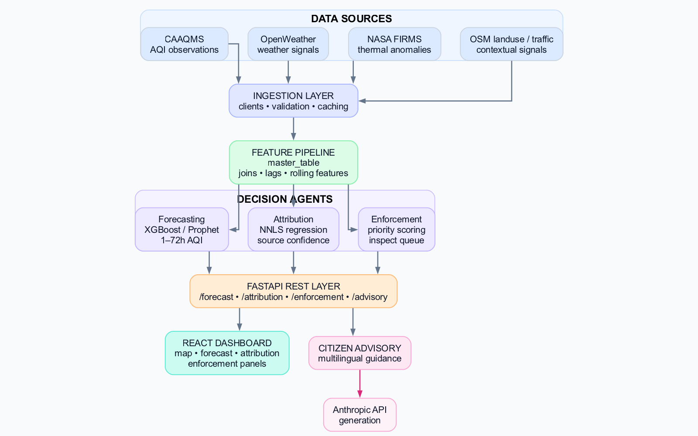

# AQI Intelligence: From Pollution Signals to Action

## 1. Problem statement and context

Air-pollution response is often reactive: a city sees a bad AQI number but
lacks a fast, defensible answer to where to look first, what may be driving the
spike, and what residents should do now. The PS5 brief highlights the gap: 24
of 50 CPCB cities are Tier 1 or Tier 2, air pollution is associated with 1.67
million annual premature deaths, and only 31% of cities have actionable
protocols.[^ps5]

AQI Intelligence is a decision-support MVP for ward-level air-quality action.
It turns observations and contextual signals into a short forecast, an
interpretable attribution view, a prioritised inspection queue, and
plain-language citizen guidance. It supports official judgement rather than
replacing it: field verification remains essential before enforcement.

[^ps5]: PS5 problem statement / hackathon brief; statistics supplied in the
challenge context.

## 2. Solution overview

The product has five focused agents connected through one shared ward-time data
model, rather than five disconnected screens.

1. **Forecasting agent** predicts ward AQI 1–72 hours ahead using lagged AQI,
weather, time, traffic, construction, industrial, and thermal-anomaly signals.
2. **Attribution agent** translates the latest source signals into traffic,
construction, industrial, and other contributions, with confidence displayed.
3. **Enforcement agent** combines AQI severity, persistence, source estimate,
and nearby-source density into a ranked inspection queue with coordinates.
4. **Dashboard agent** combines the map, forecast, attribution, enforcement,
and decision panels into one React workflow.
5. **Citizen advisory agent** creates multilingual, practical ward guidance via
Anthropic while keeping operational model outputs separate from language.

The result is a traceable loop: a forecast flags risk, attribution supplies a
hypothesis, enforcement makes a visit order, and the advisory helps people
while authorities investigate.

## 3. Architecture

{ width=100% }

CAAQMS AQI observations, OpenWeather conditions, NASA FIRMS thermal anomalies,
and OSM land-use/traffic context enter the ingestion layer. The clients validate
and cache records. A feature pipeline joins them into `master_table`, adding
lagged AQI, rolling windows, weather, and time features.

Three parallel agents then run from `master_table`: forecasting
(XGBoost/Prophet), attribution (NNLS regression), and enforcement (priority
scoring). Their results are exposed through FastAPI REST endpoints to the React
dashboard. Citizen advisory is deliberately separate: it receives ward context
from REST and calls Anthropic only for multilingual wording, keeping decision
logic inspectable.

> **Build note:** `architecture.png` is generated by
> `scripts/gen_architecture.py` once Graphviz is installed.

## 4. Tech stack

FastAPI provides typed endpoints for forecast, attribution, enforcement,
advisory, and ward data. Forecasting uses XGBoost with a fallback
gradient-boosting path and optional Prophet models for seasonality. Attribution
uses non-negative least-squares (NNLS) regression, making source contributions
more interpretable than an unconstrained model.

The frontend uses React and Vite, Recharts for forecast visuals, and
Leaflet/react-leaflet for the ward map. The advisory service integrates the
Anthropic API for multilingual messages. Pandas, scikit-learn, SciPy, and the
ingestion clients support the data and modelling layer. The modular design lets
each external feed be replaced without rewriting the dashboard or API.

## 5. Results and evidence

The following results are reproduced verbatim from `docs/evaluation_report.md`.
They are a controlled synthetic holdout (8 wards × 240 hourly observations),
not a production-accuracy claim.

### Forecast accuracy versus persistence baseline

| Horizon | Baseline RMSE | Model RMSE | Improvement |
|---|---:|---:|---:|
| 1 h | 21.91 | 0.38 | 98.3% |
| 3 h | 22.45 | 0.39 | 98.2% |
| 6 h | 23.30 | 0.51 | 97.8% |
| 12 h | 23.32 | 0.40 | 98.3% |
| 24 h | 22.26 | 0.27 | 98.8% |

The model meets the automated quality gate: mean RMSE is at least 10% lower
than persistence. The unusually large lift reflects the controlled synthetic
fixture, so the judging claim is **validated pipeline performance**, not
production accuracy.

### Attribution confidence: the next validation gate on live data

Confidence is the non-negative regression R², calculated separately for the
eight synthetic wards. All 8/8 wards fall in **0.00–0.20** (each: **0.03**);
none are shown as high-confidence evidence. This is expected because the smoke
fixture was made to test pipeline flow, not to encode a causal source/AQI
relationship. In the controlled attribution unit test with known linear source
signals, confidence passes the ≥0.80 quality gate.

This is intentionally not inflated: attribution calibration on live sensor,
traffic, permit, and satellite-fire data is the next validation gate. The MVP
already surfaces confidence so the UI can avoid overly strong causal language.

### Example enforcement recommendations

| Priority | Recommendation | Supporting evidence |
|---|---|---|
| 1 | Inspect BTM industrial sources first. | AQI 168 (Poor) for 4 days; 49% industrial + construction estimate; 3 registered sources within 1 km (nearest 0.303 km); priority score 147. |
| 2 | Inspect Mahadevapura utilities stack and flyover work zone. | AQI 154 (Poor) for 5 days; 47% industrial + construction estimate; 2 sources within 1 km (0.773/0.872 km); score 94. |
| 3 | Inspect HSR redevelopment activity. | AQI 142 (Poor) for 3 days; construction is dominant; 2 sources within 1 km (0.450/0.765 km); score 90. |

The source registry and recommendations are mock MVP data. Each recommendation
requires field verification and live municipal records before enforcement.

## 6. Judging criteria mapping

- **Innovation:** connects forecasting, transparent source hypotheses,
  inspection prioritisation, and citizen communication in one ward-level loop.
- **Business impact:** gives municipal teams an evidence-backed starting point,
  instead of a city-wide alert with no operational next step.
- **Technical excellence:** includes FastAPI contracts, model-quality tests,
  time-based evaluation, confidence reporting, and a production frontend build.
- **Scalability:** ingestion clients, `master_table`, REST endpoints, and
  independent agents permit incremental wards and data feeds.
- **UX:** a React workflow combines map, forecast, attribution, enforcement,
  and multilingual advisory panels.

## 7. Roadmap

Mocks should be replaced in phases. OpenAQ can provide operational air-quality
observations; IMD can provide India-specific weather feeds; Sentinel/MODIS
products can enrich fire, aerosol, and land-surface context. Municipal permit,
registry, and traffic feeds would make the enforcement queue locally actionable.

Before deployment, run rolling live-data backtests by ward, calibrate
attribution against inspection outcomes, set confidence thresholds that suppress
weak claims, and retain a human review/appeal trail for each recommendation.
The goal is not a prettier AQI chart—it is a verified reduction in time from an
AQI spike to a targeted, field-validated response.
